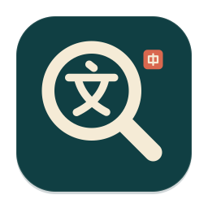

<p align="center"></p>

<h1 align="center">DigUp-ZH</h1>

<p align="center"><b>用中文描述，找回 Mac 里的文件。</b><br>
本地文件搜索 · Qwen3-VL-Embedding-2B · Apple Silicon · macOS 14 及以上</p>

<p align="center"><a href="https://github.com/tjxj/DigUp-ZH/releases">安装包与版本说明</a> · <a href="#中文友好做了什么">中文支持</a> · <a href="#从源码构建">从源码构建</a> · <a href="#致谢">致谢</a></p>

DigUp-ZH 基于 [ARahim3/DigUp](https://github.com/ARahim3/DigUp) 改进，保留菜单栏、快捷搜索、文件预览和代码搜索体验，换用 Qwen 的文字与视觉检索模型，并针对中文分词、简繁体和中文输入法做适配。

文件不必记住完整名称。你可以输入“关于报销的管理制度”“海边的一只狗”“包含登录错误的截图”，从自己选定的文件夹里查找相关内容。编号、文件名、函数名等关键词也可以直接搜索。

这是文件检索工具；搜索结果来自本机文件。

## 安装

1. 在本项目的 [Releases 页面](https://github.com/tjxj/DigUp-ZH/releases)选择 Apple Silicon 完整版 DMG。
2. 打开 DMG，把 **DigUp-ZH** 拖入“应用程序”，再从“应用程序”启动。
3. 选择需要搜索的文件夹，等待首次整理完成。完整安装包已包含模型，可离线使用。
4. 按 **⇧⌘Space** 呼出搜索框，输入中文或英文描述。

仅支持 **Apple Silicon Mac（M 系列）和 macOS 14 及以上**。Intel Mac、Windows 和 Linux 暂不在此安装包的支持范围内。模型文件合计约 **1.93 GB**，应用、索引和运行时还需要额外空间与内存；安装包的实际大小以发布页为准。

### 首次打开的系统提示

当前安装包使用本地签名，尚未经过 Apple Developer ID 签名与公证。macOS 可能提示无法验证开发者。

确认安装包来自本仓库的发布页后，先尝试打开一次，再进入 **系统设置 → 隐私与安全性**，找到 DigUp-ZH 对应的提示，选择“仍要打开”，并按系统提示确认。只对这一个应用操作，保留系统其他安全设置。

如果系统提示文件已损坏或出现其他异常，请重新核对下载来源与发布页提供的校验值，并提交问题。

## 中文友好做了什么

- **无空格中文分词**：可以直接输入“健康管理”“项目预算”，无需手动给句子加空格；中文文件名与文件夹名也参与匹配。
- **简繁体兼容**：用“发票”可匹配“發票”，搜索摘要保留文件原文。简繁字形转换不等于地区用词翻译，“软件”和“軟體”等不同用词的关联仍依赖语义检索。
- **全半角兼容**：“ＡＢＣ１２３”与“ABC123”等常见全半角写法统一处理。
- **中英混排与编号**：保留英文模型名、函数名、合同编号等内容的检索能力。
- **中文 OCR**：截图和扫描页的文字识别优先启用简体中文、繁体中文和英语。识别效果受字体、清晰度、方向和系统支持影响。
- **中文长文**：连续中文按长度分段并保留重叠，降低跨段关键词漏检的机会。
- **中文输入法**：在选词期间保护输入状态，确认候选词后再处理搜索操作。
- **中文界面**：引导、菜单、搜索、进度和设置使用中文。

中文关键词匹配与语义检索一起工作。关键词帮助查找明确字词和编号，语义检索帮助查找表达不同但内容相关的文件。相关度排序仍可能有误，请打开原文件核对。

## 能搜索什么

| 内容 | 搜索方式与边界 |
| --- | --- |
| 文本和文档 | 文件名、正文与语义；支持 txt、md、rtf、doc、docx、odt、html 等系统可读取格式 |
| PDF | 按页搜索；扫描页尝试文字识别 |
| 图片和截图 | 图片内容与识别出的文字；格式支持取决于 macOS 的图片解码能力 |
| 视频 | 对抽取的画面进行检索，可定位对应时刻；短暂画面可能被采样遗漏 |
| 代码 | 在设置里单独选择代码目录，用 `code:` 开始搜索，可跳到编辑器对应位置 |

**本版本不检索音频内容，也不识别视频对白、播客或会议录音。** 视频搜索仅针对画面。密码保护、损坏或系统无法读取的文件可能无法提取内容。

可以尝试：

- `报销发票`
- `這份財務報告`
- `合同 HT-2026-001`
- `日落时的海边`
- `code: 请求失败后自动重试`

这些是输入示例，实际命中结果取决于你选择的文件、文字提取结果和模型判断。

## 日常使用

| 操作 | 功能 |
| --- | --- |
| ⇧⌘Space | 在任意应用中打开搜索框，可在设置里调整 |
| ↑ / ↓ | 选择结果 |
| Return | 打开所选文件；支持的 PDF、视频与代码结果可定位到相应位置 |
| Space | 选中结果后预览 |
| ⌘Return | 在访达中显示文件 |
| ⌘C | 复制所选文件 |
| ⌘O | 在更大的搜索窗口中查看相同搜索 |

菜单栏里可以查看整理进度、暂停任务、添加文件夹和打开设置。第一次让视频跳转到对应时间时，macOS 可能询问是否允许控制 QuickTime Player；是否授予由你决定。

首次整理会读取选定目录中的文件，耗时受文件数量、文档长度、视频时长、Mac 配置和电源状态影响。之后会继续处理文件变化。界面中的时间估计仅供参考。

## 本地处理与数据位置

应用只读取你选择的目录。文件内容、文字识别、模型运行和搜索索引都留在本机，不要求注册账号，不上传你的文件，也不包含使用情况遥测。

完整版包含所需模型，日常检索无需联网。源码构建的小包在首次运行时需要从 Hugging Face 下载模型；点击帮助、项目或版本链接时会打开相应网站。应用不会从 DigUp 上游自动更新，版本入口指向本项目。

默认数据目录为：

`~/Library/Application Support/DigUp-ZH/`

其中保存搜索索引、日志，以及小包下载的模型。完整包自带的模型保存在应用内部。DigUp-ZH 使用独立的数据和设置目录，可以与上游 DigUp 并存。已有 DigUp 的旧索引不能直接用于本模型，需要重新整理文件。

应用会按规则跳过隐藏目录、密钥和证书、应用包、缓存，以及部分生成或第三方代码；云端占位文件不会被主动下载。你也可以额外排除文件夹和文件类型。跳过规则不能覆盖所有私人资料，选择目录时请按自己的需要控制范围。日志可能含有文件路径和搜索词，分享前请先检查。

卸载时先退出应用，再删除“应用程序”中的 DigUp-ZH。如需一并清除本地记录，可在访达中前往上述数据目录并删除；设置文件为 `~/Library/Preferences/com.tjxj.DigUp-ZH.plist`。

## 使用的模型

原始模型为 [Qwen/Qwen3-VL-Embedding-2B](https://huggingface.co/Qwen/Qwen3-VL-Embedding-2B)。本项目使用 [DevQuasar 提供的 GGUF 文件](https://huggingface.co/DevQuasar/Qwen.Qwen3-VL-Embedding-2B-GGUF)，文字模型采用用户指定的 Q4_K_M，视觉组件采用同仓库的 f16 文件：

| 文件 | 大小 |
| --- | ---: |
| `Qwen.Qwen3-VL-Embedding-2B.Q4_K_M.gguf` | 1,107,410,528 字节 |
| `mmproj-Qwen.Qwen3-VL-Embedding-2B.f16.gguf` | 819,395,136 字节 |
| 合计 | **1,926,805,664 字节，约 1.93 GB** |

两者配套使用。文件下载版本及校验值固定在 [ModelFiles.swift](Sources/DigUpKit/ModelFiles.swift)。运行时使用 [llama.cpp](https://github.com/ggml-org/llama.cpp)；文字和图片生成 2048 维表示，与中文关键词匹配结合排序。

本项目未沿用上游的速度、内存或准确率数字，也未把模型官方榜单当作本应用的实测成绩。量化版本、图片处理方式和文件内容都会影响结果。

## 从源码构建

需要 Apple Silicon Mac、Swift 6.2 工具链、macOS SDK、Git，以及 CMake。可使用完整 Xcode 或匹配的 Command Line Tools；测试脚本会自动选择适合当前环境的参数。没有 CMake 时，运行库构建脚本也支持通过 `uv` 准备工具。

```sh
git clone https://github.com/tjxj/DigUp-ZH.git
cd DigUp-ZH
scripts/build-llama.sh
swift build -c release
bash scripts/test.sh
./build.sh
```

应用输出到 `build.noindex/DigUp-ZH.app`。默认源码构建不内置模型，首次运行会下载上表中的两个文件。

制作离线完整版时，把上述两个模型文件放入项目根目录的 `.models/`，或用 `MODEL_DIR` 指向已有目录：

```sh
# 生成包含模型的应用
WITH_MODELS=1 MODEL_DIR="$PWD/.models" ./build.sh

# 生成完整 DMG；默认内置模型，并在复制前验证文件校验值
MODEL_DIR="$PWD/.models" bash scripts/release.sh
```

当前版本的输出为 `dist/DigUp-ZH-0.1.0-arm64.dmg`。脚本会验证磁盘映像并显示其 SHA-256；再次打包前，需要先移走同名旧产物。若只需要不含模型的小包，可显式设置 `WITH_MODELS=0`。

默认使用本地签名。具备自己的 Apple Developer ID 时，可设置 `SIGN_ID`；同时设置已配置的 `NOTARY_PROFILE` 后，发布脚本会提交 Apple 公证。不得把签名材料、模型、索引或个人资料提交到仓库。

命令行工具位于 `.build/release/digup`，可用 `--help` 查看索引、搜索与评估命令。旧模型生成的向量不与本模型混用。

### 测试

`bash scripts/test.sh` 包含中文无空格查询、简繁体、全半角、文件名、编号、摘要原文保留、长文分段和模型配置等检查。真实模型测试还需要完整的模型文件。上游的示例评估保留为开发资料，不能作为 DigUp-ZH 的中文检索成绩。

贡献改动时请同时给出可复现样例和实际验证结果，参见 [CONTRIBUTING.md](CONTRIBUTING.md)。

本版本的实际检查范围、复现命令和未完成的人工检查见 [验证记录](docs/TESTING.md)。

## 致谢

DigUp-ZH 是在以下开源工作的基础上完成的：

- **[DigUp / ARahim3](https://github.com/ARahim3/DigUp)**：本项目直接基于 DigUp 的原生 macOS 应用、文件提取、索引、搜索与交互设计继续开发。感谢原作者 Abdur Rahim；保留其 MIT 版权和许可声明。
- **[Qwen 团队](https://huggingface.co/Qwen/Qwen3-VL-Embedding-2B)**：提供 Qwen3-VL-Embedding-2B 原始模型，模型采用 Apache 2.0 许可证。
- **[DevQuasar](https://huggingface.co/DevQuasar/Qwen.Qwen3-VL-Embedding-2B-GGUF)**：提供本项目采用的 GGUF 转换与量化文件。
- **[llama.cpp / ggml](https://github.com/ggml-org/llama.cpp)**：提供本地推理运行库，采用 MIT 许可证。

本项目为独立社区改进版本，与上述项目及 Apple 不存在官方隶属或背书关系。

## 许可证

应用代码采用 [MIT 许可证](LICENSE)。上游版权完整保留。模型权重按其 Apache 2.0 许可证使用；随包提供的第三方声明与许可证原文见 [Acknowledgements.txt](Resources/Acknowledgements.txt)，安装后也可在应用包的 `Contents/Resources/Acknowledgements.txt` 中查看。
